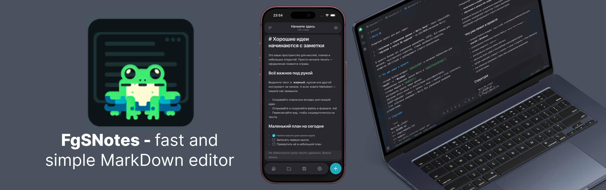

# FgSNotes

[](https://electronjs.org/) [](LICENSE) [](https://github.com/ArduRadioKot/FgSNotes)

FgSNotes is a desktop Markdown editor built with Electron. The application combines an editor and a live preview, so you can see the rendered document while working on it.



## Features

- create, open, and save Markdown files;
- work with multiple documents in tabs;
- switch between Editor, Split, and Preview modes;
- preview Markdown in real time;
- use the formatting toolbar for headings, emphasis, lists, quotes, links, images, and code blocks;
- configure the font, text size, line spacing, tab size, and word wrapping;
- switch the interface and preview themes;
- resize the editor and preview panels;
- write formulas in LaTeX (`$E=mc^2$` inline, `$$ ... $$` as a block), typeset locally by KaTeX;
- rewrite, fix, translate or continue text with an AI chat: a local model (Ollama, LM Studio; desktop only) or your own key for OpenAI, Claude, Gemini, OpenRouter, Groq or a custom server.

## AI assistant

A chat that drops down next to the editor (`Ctrl / Cmd + J`). With a selection it works on the selection, otherwise on the whole note.
Pick an action (continue, improve, fix mistakes, shorten, translate, summary, to-do list, headings) or ask anything; answers stream in,
can replace the selection, be inserted or copied, and chats are kept in a history.

**Providers** (Settings → ИИ):

| Where | Providers | Needs |
| --- | --- | --- |
| On this computer | [Ollama](https://ollama.com), LM Studio | nothing (no key, no internet after the model is downloaded) |
| Hosted | OpenAI, Anthropic Claude, Google Gemini, OpenRouter, Groq | your API key |
| Anything else | custom server speaking the OpenAI API (vLLM, llama.cpp, a proxy...) | address, optional key |

Local providers keep your text on the computer. Hosted ones send the attached text to the provider: the settings say which is which.
API keys are stored in the main process only, encrypted with the system keychain (Electron `safeStorage`) when it is available, and are never
shown or sent back to the page. All requests go through the main process (`providers.js`, `ollama.js`), because a `file://` page cannot call these APIs (CORS).

Ollama has a guided installer (download link, one-click start, model download with progress, a field for any model name).
**On a phone** (the Capacitor app) the assistant is a full-screen sheet opened from the sparkles button in the bottom bar (`src/ai/web-backend.js`). It works two ways:
- **On the device**: small models run inside the app with transformers.js and ONNX Runtime Web (WebGPU when the phone has it, WebAssembly otherwise): Qwen 3.5 0.8B and 2B, Mistral Ministral 3 3B, Phi-3.5 mini. A model is downloaded once (0.5-2.7 GB), then works offline and the text never leaves the phone.
  The engine (`device-engine/`, built by `npm run device:build`, which `npm run web:build` runs for you) is loaded only when a model is used. Not verified on real phones yet; the larger models need 6-8 GB of RAM.
- **In the cloud**: OpenAI, Claude, Gemini, OpenRouter, Groq or an `https` server, with your own key (kept in the app's storage, without system encryption).

Ollama and LM Studio are desktop-only: the phone does not connect to a computer over the network.

## Running from Source

Node.js and npm are required.

```bash
npm install
npm start
```

The application window starts with `npm start`.

## Tests

```bash
npm test
```

Tests are located in the `tests/` directory and use Node.js's built-in test runner.

## Building

To create a local unpacked build:

```bash
npm run dist
```

The following commands create installers and archives:

```bash
npm run build:mac       # macOS, arm64 and x64
npm run build:win       # Windows, x64 and ia32
npm run build:linux     # Linux, x64
npm run build:all       # all supported platforms
```

The build commands use Electron Builder. Output is written to the `dist/` directory.

macOS installers are named by architecture (`FgSNotes-<version>-arm64.dmg`, `FgSNotes-<version>-x64.dmg`). **On an Apple Silicon Mac (M1 and newer) install the `arm64` one.**
The `x64` build runs there under Rosetta and starts several times slower; the app notices this and shows a one-time hint.

## Keyboard Shortcuts

All shortcuts can be changed in Settings → Горячие клавиши: click a shortcut, press the new combination (Esc cancels, Backspace clears it).
A shortcut taken by another action is moved to the new one, and the old action is left without one. Keys are matched by position, so shortcuts also work on a Russian layout.
(On Windows and Linux `Cmd` below is `Ctrl`.)

| Action | Default |
| ------ | ------- |
| New document / Open / Save | `Cmd N` / `Cmd O` / `Cmd S` |
| Close tab / next / previous | `Cmd Alt W` / `Ctrl Tab` / `Ctrl Shift Tab` |
| Bold / italic / underline / strikethrough | `Cmd B` / `Cmd I` / `Cmd U` / `Cmd Shift X` |
| Heading / list / task list / quote | `Cmd Shift H` / `Cmd Shift L` / `Cmd Shift T` / `Cmd Shift .` |
| Link / code block | `Cmd K` / `Cmd Shift E` |
| Editor / Live / Side by side / Preview | `Cmd 1` / `Cmd 2` / `Cmd 3` / `Cmd 4` |
| Settings / light-dark theme | `Cmd ,` / `Cmd Shift D` |
| AI assistant | `Cmd J` |

`Tab` and `Shift Tab` in the editor indent and outdent (the current line on a list, every selected line otherwise); `Esc`, then `Tab` leaves the field.

## Project Structure

```text
main.js                 Electron main process
preload.js              Secure bridge between processes
ollama.js               Ollama client (models, streaming chat, install helpers)
providers.js            OpenAI-compatible / Claude / Gemini / Ollama behind one interface
keystore.js             API keys, encrypted with the system keychain
src/MarkDownEditor.html Application markup
src/editor.js           Document and preview handling
src/markdown.js         Markdown processing
src/settings.js         Editor settings
src/theme.js            Interface themes
src/resize.js           Panel resizing
src/highlight.js        Syntax highlighting
src/math.js             LaTeX formulas (KaTeX, src/vendor/katex)
src/ai.js               AI assistant panel and its settings
src/shortcuts.js        Keyboard shortcuts: actions, defaults, the settings editor
src/about.js            About page, external links
src/styles.css          Application styles
tests/                  Automated tests
```

## License

The project is distributed under the license specified in [LICENSE](LICENSE).

## Mobile app (Capacitor)

The same web code runs as an iOS and Android app. Capacitor config: `capacitor.config.json`, native projects: `ios/` and `android/`.

```bash
npm run cap:sync   # build www/ from src/ and copy it into both native projects
npm run ios        # sync and open Xcode
npm run android    # sync and open Android Studio
```

Phones use a one-pane layout with a bottom action bar. Saving opens the system share sheet (Save to Files); Liquid Glass and the theme store are desktop-only. Building for iOS needs Xcode, for Android needs Android Studio with the SDK.

### Install on an iPhone over a cable

1. `npm run ios` (builds the web part, syncs it and opens Xcode).
2. In Xcode choose the **App** target → **Signing & Capabilities**: tick _Automatically manage signing_ and pick your team (a free Apple ID works).
3. Connect the iPhone, unlock it, tap **Trust**, and turn on **Settings → Privacy & Security → Developer Mode** (the phone restarts).
4. Choose your iPhone at the top of Xcode and press **Run**.
5. First launch: **Settings → General → VPN & Device Management** → your Apple ID → **Trust**. With a free Apple ID the build stops working after 7 days; run it again to renew.

Icons and splash screens for iOS and Android are generated from `src/icon.png` with `npm run icons` (needs ImageMagick), then `npm run cap:sync`.
